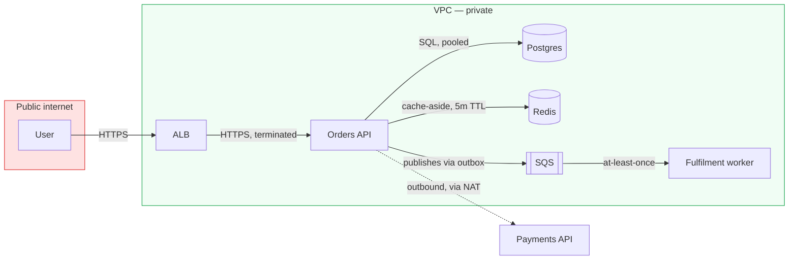

# Diagrams

## Purpose

> Diagramas versionados como texto dentro del repositorio. Un HTML de diseño o un boceto de pantalla no va aquí: para eso sirve una skill de mockups HTML, si el proyecto la tiene. Todo diagrama se dibuja desde el código real, no de memoria ([[no-asumir-separar-confirmado]]); nunca con datos reales ni secretos ([[secretos]]).

Write technical diagrams as text: they are versioned, show up in code review, and can be corrected when the system changes. A PNG in a wiki, by contrast, may have matched the system two years ago and no longer does.

## When to Use

- Documenting an architecture, a data flow, or a request path.
- Explaining a sequence of interactions between services.
- Visualizing a state machine or a decision flow.
- Adding a diagram to a README, an ADR, or a design document.

## Capabilities

- Mermaid: flowcharts, sequence diagrams, state diagrams, ER diagrams, Gantt.
- Choosing the diagram type.
- Layout control and readability.
- Rendering to SVG or PNG where Mermaid is not supported.

## Inputs

- The system, process, or interaction being described.
- The audience and what they need to understand from it.

## Outputs

- A diagram as text, stored in the repository next to the code it describes.
- A rendered image, when the destination cannot display Mermaid.

## Workflow

1. **Choose the type by the question** — Sequence diagrams answer "what talks to what, and in what order". Flowcharts answer "what paths exist through this". State diagrams answer "which states exist and how you move between them". A wrong type gives a diagram that is technically correct and still useless.
2. **Draw one thing** — A single drawing that mixes architecture, data flow and deployment topology ends up showing none of them clearly.
3. **Label the edges** — An arrow with no text between two boxes says very little. "publishes OrderPlaced" says a great deal.
4. **Keep it under about fifteen nodes** — Beyond that it is a map, not a diagram, and nobody will read it.
5. **Keep it in version control** — Next to the code. A diagram that is not reviewed together with the change it describes drifts without anyone noticing.

## Best Practices

- A diagram that cannot be updated in a pull request tends not to be updated. That is the core argument for diagrams as code instead of a drawing tool.
- Unlabelled arrows are the most common defect in a diagram. The relationship between two components is the information; the boxes only anchor it.
- When they matter, show trust boundaries. A diagram that does not separate "inside our network" from "public internet" leaves out what a security review needs.
- In a sequence diagram of anything important, show the failure path too, not only the happy path. The interesting part of a payment flow is what happens when the gateway times out.
- Do not try to show every component. A diagram is an abstraction; a complete one would be the code itself.
- For documentation sites, render to SVG: it scales and the text stays selectable.

## Examples

**Sequence diagram showing the failure path, which is the part that matters:**

```mermaid
sequenceDiagram
    autonumber
    participant C as Client
    participant API as Orders API
    participant P as Payments (3rd party)
    participant DB as Postgres
    participant Q as Outbox → SQS

    C->>API: POST /orders (Idempotency-Key)
    API->>DB: BEGIN; check idempotency key
    alt key already seen
        DB-->>API: existing response
        API-->>C: 200 (replayed, no double charge)
    else new request
        API->>P: authorize(amount)
        alt authorized
            P-->>API: 200 auth_id
            API->>DB: INSERT order + INSERT outbox(order.placed); COMMIT
            API-->>C: 201 Created
            Q->>Q: relay publishes order.placed
        else declined
            P-->>API: 402 card_declined
            API->>DB: ROLLBACK
            API-->>C: 402 Payment Required
        else timeout (the case that actually hurts)
            P--xAPI: no response after 5s
            API->>DB: ROLLBACK
            API-->>C: 503 + Retry-After
            Note over API,P: The charge may or may not have succeeded.<br/>Reconciliation job resolves it against the<br/>gateway within 15 minutes.
        end
    end
```

The timeout branch is the one worth drawing: the happy path is already obvious to everyone.

**Flowchart with labelled edges and a visible trust boundary:**



## Notes

- Every arrow here carries a label saying what actually crosses it. Without those labels, the same boxes convey roughly a tenth as much.
- GitHub, GitLab and most documentation platforms render Mermaid natively. A diagram inside a Markdown file is reviewed in the pull request together with the code it describes, which is the only mechanism that keeps it accurate.
- When a diagram must be pixel-precise or heavily styled, Mermaid will be frustrating. Use it for the 95% of diagrams where accuracy and maintainability matter more than looks.
